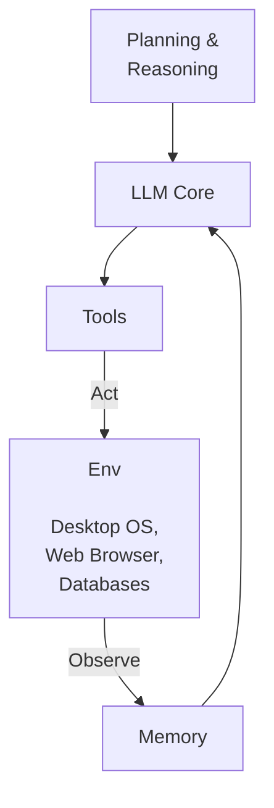

# Lecture 1 — Foundations & Landscape: What Are Agentic Systems?

- Date: 2026-09-23
- Source: https://cs329z.stanford.edu · https://www.youtube.com/watch?v=DGI4vucR71w

## Topics covered

- Multi agent system
- Evaluation
- Tool and function calls
- RAG
- MCP

> Agents → agens (Latin) — one who acts

## Anatomy of an agent

## Reasoning patterns

- **CoT (chain-of-thought)** — the model writes out intermediate steps before answering, which helps on multi-step problems.
- **ReAct** — interleaves reasoning with actions: think, call a tool, read the observation, think again.
- **ReAct + Reflection** — after acting, the agent critiques its own trace or output and retries using that feedback.
- **Multi agent debate** — several model instances answer, then critique each other over rounds until they converge on one answer.
- **Multi agent reasoning** — an orchestrator agent decomposes the task, delegates sub-tasks to worker agents, and combines what they return.
