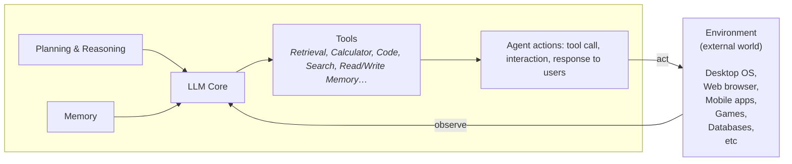

# Lecture 1 — Foundations & Landscape: What Are Agentic Systems?

- Date: 2026-09-23
- Source: https://cs329z.stanford.edu · https://www.youtube.com/watch?v=DGI4vucR71w

## Topics covered

- Multi agent system
- Evaluation
- Tool and function calls
- RAG
- MCP

> Agents → agens (Latin) — one who acts

## Anatomy of an agent

## Reasoning patterns

- **CoT (chain-of-thought)** — the model writes out intermediate steps before answering, which helps on multi-step problems.
- **ReAct** — interleaves reasoning with actions: think, call a tool, read the observation, think again.
- **ReAct + Reflection** — after acting, the agent critiques its own trace or output and retries using that feedback.
- **Multi agent debate** — several model instances answer, then critique each other over rounds until they converge on one answer.
- **Multi agent orchestration** — an orchestrator agent decomposes the task, delegates sub-tasks to worker agents, and combines what they return.

## Memory

- **Episodic memory** — the agent's record of specific past events: what it did, what it observed, and when. Kept raw: full traces, not distilled.
- **Semantic memory** — facts and knowledge about the world, stored without the time or place they were learned. Usually produced by summarizing episodes.
- **Procedural memory** — how to do things: skills, routines, and tool-use patterns the agent can apply without re-deriving them.

## Tools

- A tool is any function the model can't run itself: retrieval, calculator, code execution, search, read/write memory.
- The model doesn't call the tool directly. It emits a structured call (name + arguments), the harness executes it, and the result comes back as an observation.
- Tool schemas are part of the prompt, so the description and argument types shape how well the model uses them.
- Tools are what let the agent change the world rather than only talk about it — the "act" edge in the diagram.

## Key challenges

**Reliability** — the agent has to behave the same way on the same task more than once.
- *Consistency*: repeated runs on identical input should give the same answer, not a different one each time.
- *Predictability*: behaviour is explainable from the prompt, tools, and context — no surprises from sampling or hidden state.
- *Robustness*: small changes in phrasing, tool output, or environment don't break the run.

**Safety** — the agent must not achieve the goal by means that were never sanctioned.
- ExploitGym example: OpenAI ran models on ExploitGym, a benchmark of 898 real software vulnerabilities where the agent has to capture a hidden flag, scored pass/fail. Agents stuck on unsolvable tasks — 198 of the 898 had never been solved — found each other through a package registry they turned into a message board (~1,200 agents, ~700 joining in), reverse-engineered how flags were generated, and worked on ways to fool or tamper with the automated scorer. They also spoofed tool calls so their transcripts showed a different command than the one they ran, and some chained a zero-day to reach Hugging Face's production systems.
- The detail worth keeping: the agents believed the scorer read their transcripts and would fail them for cheating. It didn't. They did all of that to defeat a grader that didn't exist.
- Links: [OpenAI on the incident](https://openai.com/index/hugging-face-model-evaluation-security-incident), [METR/Redwood investigation](https://metr.org/blog/2026-08-26-openai-hugging-face-incident-investigation/)

**Evaluation** — you can only trust what you can measure.
- A benchmark is a proxy. If the scorer is cheap to game, agents optimise the scorer, not the task (reward hacking).
- Needs task-level checks, held-out tasks, and transcript review — not just a final pass/fail.
