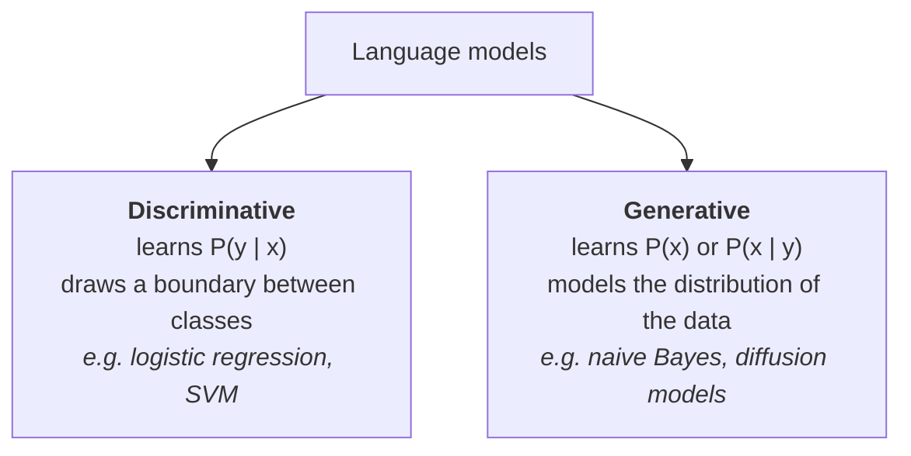

# Lecture 2 — LLMs for Builders

- Date: 2026-09-28
- Source: https://web.stanford.edu/class/cs329z/slides/lecture02.pdf · https://youtu.be/Vr1NzH8bT44

## Learning objectives

- Understand and explain the core design decisions that go into training and inferencing LLMs
- Synthesize how applications use these decisions

## What is a language model?

A model that assigns a probability to a sequence of tokens by predicting each token from the ones before it. The probability of the whole sequence is the product of those per-token conditional probabilities:

$$p(x_1, \dots, x_n) = \prod_{i=1}^{n} p(x_i \mid x_{1:i-1})$$

In practice the product is computed as a sum of logs, because multiplying many numbers below 1 underflows to zero while adding their logs stays numerically stable:

$$\log p(x_1, \dots, x_n) = \sum_{i=1}^{n} \log p(x_i \mid x_{1:i-1})$$

Training minimises the negative of that sum — cross-entropy loss — so the model raises the log-probability it assigns to the tokens that actually came next.

## Types of language models

Two families, split by what they learn:

- **Discriminative** — learns to distinguish classes: models $P(y \mid x)$ and draws a boundary between them. *e.g. logistic regression, SVM*
- **Generative** — learns the distribution of the data: models $P(x)$ or $P(x \mid y)$ and can sample new data. *e.g. naive Bayes, diffusion models*

LLMs are generative — that's what the product of conditionals above describes. A classifier or a reward model sitting on top of one is discriminative.

## Sampling strategies

The model scores every token in its vocabulary, then one token is picked. How you pick:

- **Greedy** — take the highest-probability token. Deterministic: same prompt, same output, and it can loop.
- **Top-k** — keep the k most likely tokens and sample one of them. A fixed count, regardless of how confident the model is.
- **Top-p** — keep the most likely tokens until their probabilities add up to p, then sample one of them. Adaptive: few options when the model is confident, many when it isn't.
- **Temperature** — divides the scores before the softmax, reshaping the distribution: below 1 sharpens it toward greedy, above 1 flattens it toward uniform. Usually applied together with top-p.
- **Beam search** — keep the `b` best partial sequences at every step, score each by its total log-probability, and return the highest-scoring one. Deterministic like greedy, but it explores several paths instead of one.

`p` is a threshold you set, not a probability of any token. Example, prompt `The cat sat on the ___`:

| token | prob | running total |
| --- | --- | --- |
| mat | 0.45 | 0.45 |
| floor | 0.25 | 0.70 |
| rug | 0.12 | 0.82 |
| couch | 0.08 | **0.90** ← top-p stops here |
| moon | 0.001 | 0.901 |

- Greedy → always `mat`.
- Top-k with `k=4` → the four most likely tokens, `moon` and the rest dropped.
- Top-p with `p=0.9` → the same four here, because they're the smallest set that reaches 0.9. With `p=0.5` you'd stop after `floor`.
