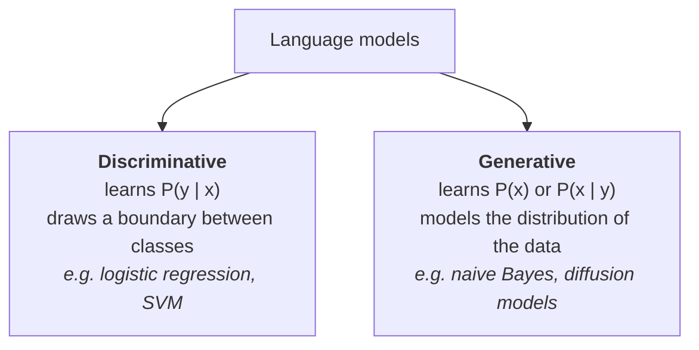

# Lecture 2 — LLMs for Builders

- Date: 2026-09-28
- Source: https://web.stanford.edu/class/cs329z/slides/lecture02.pdf · https://youtu.be/Vr1NzH8bT44

## Learning objectives

- Understand and explain the core design decisions that go into training and inferencing LLMs
- Synthesize how applications use these decisions

## What is a language model?

A model that assigns a probability to a sequence of tokens by predicting each token from the ones before it. The probability of the whole sequence is the product of those per-token conditional probabilities:

$$p(x_1, \dots, x_n) = \prod_{i=1}^{n} p(x_i \mid x_{1:i-1})$$

In practice the product is computed as a sum of logs, because multiplying many numbers below 1 underflows to zero while adding their logs stays numerically stable:

$$\log p(x_1, \dots, x_n) = \sum_{i=1}^{n} \log p(x_i \mid x_{1:i-1})$$

Training minimises the negative of that sum — cross-entropy loss — so the model raises the log-probability it assigns to the tokens that actually came next.

## Types of language models

Two families, split by what they learn:

- **Discriminative** — learns to distinguish classes: models $P(y \mid x)$ and draws a boundary between them. *e.g. logistic regression, SVM*
- **Generative** — learns the distribution of the data: models $P(x)$ or $P(x \mid y)$ and can sample new data. *e.g. naive Bayes, diffusion models*

LLMs are generative — that's what the product of conditionals above describes. A classifier or a reward model sitting on top of one is discriminative.
