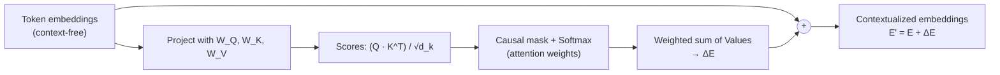
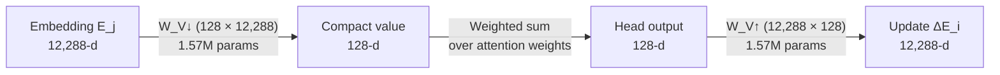
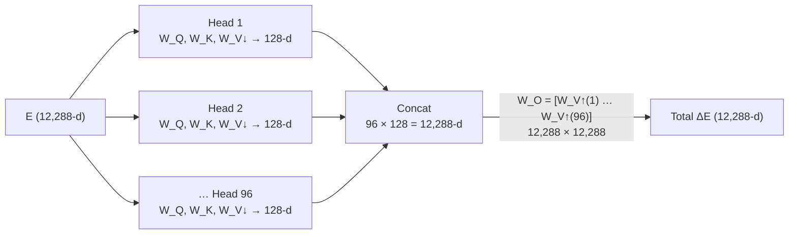
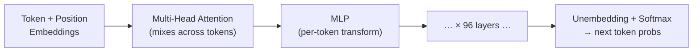

# Attention in Transformers

- Date: 2026-11-22
- Source: https://www.youtube.com/watch?v=eMlx5fFNoYc (3Blue1Brown — *Attention in transformers, step-by-step*)

## Why attention?

Initial token embeddings are static lookups — a word gets the same vector regardless of where it appears. `mole` starts as the exact same vector in *"American shrew mole"*, *"one mole of carbon dioxide"*, and *"take a biopsy of the mole"*.

Attention lets tokens exchange information so each embedding $\vec{E}_i$ shifts by an update $\Delta \vec{E}_i$ toward its context-specific meaning:

$$\vec{E}_i' = \vec{E}_i + \Delta \vec{E}_i$$

## Queries and Keys (the attention pattern)

To decide which earlier tokens matter to token $i$, every embedding is projected into a smaller query/key space (dimension $d_k$, e.g. 128 in GPT-3 vs. 12,288 for embeddings):

- **Query ($\vec{Q}_i = W_Q \vec{E}_i$)** — what token $i$ is looking for. In *"a fluffy blue creature roamed the verdant forest"*, a head's query for `creature` might encode *"are there adjectives immediately before me?"*.
- **Key ($\vec{K}_j = W_K \vec{E}_j$)** — what token $j$ advertises about itself. The keys for `fluffy` and `blue` align with that query because they encode *"I am an adjective"*.
- **Alignment score** — the dot product $\vec{Q}_i \cdot \vec{K}_j$ measures how strongly token $i$ should attend to token $j$. Large positive = strong match; negative or zero = ignore.
- **Scaling and softmax** — divide scores by $\sqrt{d_k}$ so dot products don't grow too large and saturate softmax, then apply softmax across all keys $j$ for each query $i$ so the weights are in $[0, 1]$ and sum to 1.

## Masking and context size

During training, a model processes an entire sequence at once and predicts the next token at every position simultaneously. If earlier tokens could attend to later ones, the model would see the answer it is supposed to predict.

- **Causal masking** — before softmax, every pair where key $j$ comes after query $i$ is set to $-\infty$, which becomes $0$ after softmax.

| key / query | a | fluffy | blue | creature |
| --- | --- | --- | --- | --- |
| **a** | $a_{1,1}$ | $a_{2,1}$ | $a_{3,1}$ | $a_{4,1}$ |
| **fluffy** | 0 | $a_{2,2}$ | $a_{3,2}$ | $a_{4,2}$ |
| **blue** | 0 | 0 | $a_{3,3}$ | $a_{4,3}$ |
| **creature** | 0 | 0 | 0 | $a_{4,4}$ |

Each column sums to 1 (query $i$ only distributes weight over keys $1 \dots i$).

- **Quadratic scaling** — the attention grid has $n^2$ entries for a sequence of length $n$, which is why long **context size** (e.g. 2,048 tokens in GPT-3) becomes a compute and memory bottleneck.

## Values (updating embeddings)

Attention weights only tell token $i$ *how much* to pay attention to token $j$. **Values** specify *what* to add to token $i$'s embedding when it does:

- Multiply each token's embedding by a learned matrix $W_V$ to get $\vec{V}_j = W_V \vec{E}_j$ — e.g. *"if a noun attends to `blue`, nudge its embedding in the direction of blueness."*
- Token $i$'s update is the attention-weighted sum of all value vectors:

$$\Delta \vec{E}_i = \sum_{j=1}^{i} a_{i,j} \vec{V}_j$$

### Worked example (`creature` in *"a fluffy blue creature"*)

Suppose an adjective-finding head computes scaled dot products for the `creature` query column, applies softmax, and gets the following weights:

| key token | scaled score $\vec{Q}_{\text{creature}} \cdot \vec{K}_j / \sqrt{d_k}$ | softmax weight $a_{4,j}$ | value contribution |
| --- | --- | --- | --- |
| `a` | $-1.2$ | `0.02` | $0.02\,\vec{V}_{\text{a}}$ |
| `fluffy` | $+1.9$ | `0.45` | $0.45\,\vec{V}_{\text{fluffy}}$ |
| `blue` | $+1.9$ | `0.45` | $0.45\,\vec{V}_{\text{blue}}$ |
| `creature` | $+0.2$ | `0.08` | $0.08\,\vec{V}_{\text{creature}}$ |

Summing the right column gives $\Delta \vec{E}_{\text{creature}}$ — mostly a blend of "fluffiness" and "blueness" — and adding it to $\vec{E}_{\text{creature}}$ moves the vector from a generic *creature* to a *fluffy blue creature*.

In compact matrix form (with causal mask $M$ containing $0$ for allowed positions and $-\infty$ for future positions):

$$\text{Attention}(Q, K, V) = \text{softmax}\!\left(\frac{Q K^T}{\sqrt{d_k}} + M\right) V$$

## Low-rank value factorization

A full square $W_V$ mapping $d_{\text{model}} \to d_{\text{model}}$ would be $12{,}288 \times 12{,}288 \approx 151\text{M}$ parameters for a *single* head — nearly 100× larger than $W_Q$ or $W_K$.

Instead, $W_V$ is factored into two thin matrices through the same $d_k$-dimensional bottleneck:

- **Value-down ($W_V^\downarrow$, shape $d_k \times d_{\text{model}}$)** — compresses the embedding into a compact value vector (128-d in GPT-3).
- **Value-up ($W_V^\uparrow$, shape $d_{\text{model}} \times d_k$)** — projects the weighted value sum back into the full embedding space.

This constrains $W_V = W_V^\uparrow W_V^\downarrow$ to be low-rank and brings each head's value parameter budget down from ~151M to ~3.15M — matching $W_Q$ and $W_K$ combined.

## Multi-head attention and the output matrix

One attention head only captures one kind of relationship (such as adjectives modifying nouns). Language requires tracking many relationships at once — grammar, pronouns, entity attributes, formatting — so each attention block runs $h$ heads in parallel, each with its own $W_Q, W_K, W_V^\downarrow, W_V^\uparrow$:

- Every head proposes its own $\Delta \vec{E}_i^{(k)}$, and all of them are added to $\vec{E}_i$:

$$\vec{E}_i' = \vec{E}_i + \sum_{k=1}^{h} \Delta \vec{E}_i^{(k)}$$

- **Output matrix ($W_O$)** — in practice, the $h$ value-up matrices $W_V^{\uparrow(1)}, \dots, W_V^{\uparrow(h)}$ are stacked side-by-side into one $d_{\text{model}} \times (h \cdot d_k)$ matrix $W_O$, multiplied against the concatenated low-dimensional head outputs. It is algebraically identical to summing each head's individual $W_V^\uparrow$ projection.

## Self-attention vs. cross-attention

- **Self-attention** — queries, keys, and values all come from the same sequence (used in decoder-only LLMs like GPT).
- **Cross-attention** — queries come from one sequence while keys and values come from another (e.g. translating French to English, or transcribing audio to text). No causal masking is needed on the source sequence since all of it is available up front.

## Parameter count walkthrough (GPT-3 example)

GPT-3 uses $d_{\text{model}} = 12{,}288$, head dimension $d_k = 128$, $h = 96$ heads per block (chosen so $96 \times 128 = 12{,}288$), and $96$ transformer layers:

1. **One $W_Q$ or $W_K$ matrix**: $128 \times 12{,}288 = 1{,}572{,}864 \approx 1.57\text{M}$ parameters.
2. **One factored $W_V$ ($W_V^\downarrow$ and $W_V^\uparrow$)**: $2 \times (128 \times 12{,}288) = 3{,}145{,}728 \approx 3.15\text{M}$ parameters (vs. $12{,}288^2 \approx 151\text{M}$ unfactored).
3. **One complete head ($W_Q, W_K, W_V^\downarrow, W_V^\uparrow$)**: $4 \times 1{,}572{,}864 = 6{,}291{,}456 \approx 6.29\text{M}$ parameters.
4. **One multi-head attention block (96 heads)**: $96 \times 6{,}291{,}456 = 603{,}979{,}776 \approx 604\text{M}$ parameters (equivalently $4 \times 12{,}288^2$).
5. **All 96 attention layers in GPT-3**: $96 \times 603{,}979{,}776 \approx 58\text{B}$ parameters — roughly **one-third** of GPT-3's 175B total.

| Level | Calculation | Parameters |
| --- | --- | --- |
| $W_Q$ or $W_K$ (1 head) | $128 \times 12{,}288$ | ~1.57M |
| $W_V^\downarrow + W_V^\uparrow$ (1 head) | $2 \times 128 \times 12{,}288$ | ~3.15M |
| Full single head | $4 \times 128 \times 12{,}288$ | ~6.29M |
| Multi-head block (96 heads) | $96 \times 6.29\text{M}$ | ~604M |
| All 96 attention layers | $96 \times 604\text{M}$ | ~58B (~1/3 of 175B) |

## Where attention sits in a transformer

A transformer alternates **multi-head attention** layers (which move information *between* tokens) with **MLP** layers (which process each token vector independently and hold most of the remaining ~2/3 of parameters). Stacking many layers lets later attention heads operate on already-contextualized embeddings to capture higher-level meaning.
